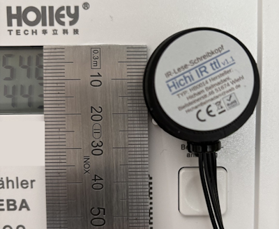
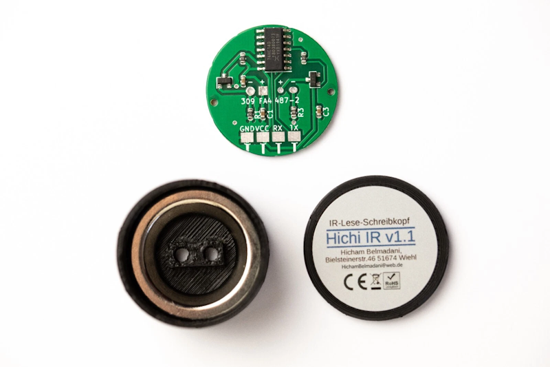

.. include:: ../Plugin/_plugin_substitutions_p15x.repl
.. _P155_page:

|P155_typename|
==================================================

|P155_shortinfo|

Plugin details
--------------

Type: |P155_type|

Port Type: |P155_porttype|

Name: |P155_name|

Status ESP32: |P155_status|

Status ESP8266: |P155_status_lb|

GitHub: |P155_github|_

Maintainer: |P155_maintainer|

Used libraries: |P155_usedlibraries|

Description
-----------

Reads energy and power values from an electricity meter via its optical
infrared interface. Two protocols are supported:

* **SML** (Smart Message Language), used by most modern German smart meters
  (moderne Messeinrichtung, mME). The meter sends a data telegram on its own,
  usually every 1-4 seconds.
* **D0** (IEC 62056-21, text telegrams), used by older electronic meters that
  push their data at 9600 baud.

Up to 4 values per task. The plugin parses the SML telegram dynamically
(type-length fields, scaler), so it works with any SML-compliant meter without
meter-specific settings.

Several meters can be read by one ESP: create one task per meter, each with its
own serial port and reading head.

Hardware
--------

Reading head
^^^^^^^^^^^^

An IR reading head with TTL/UART output (3.3 V) is needed, for example:

* Hichi TTL IR reader
* bitShake SmartMeterReader UART

The head is attached magnetically over the IR interface (the two LEDs on the front
of the meter). The plugin uses a serial port of the ESP; a hardware serial port
is recommended.

Wiring
^^^^^^

Example for an ESP32 with Serial2:

.. code-block:: none

  IR reader    ESP32
  TXD      --> GPIO 16 (RX)
  RXD      --> GPIO 17 (TX)
  VCC      --> 3.3V
  GND      --> GND

Only RX is needed for SML and D0 push meters; TX can stay unconnected.

Meter preparation
^^^^^^^^^^^^^^^^^

Many SML meters send only the energy counters by default. To get the current
power (and on some meters voltage and current), the **extended data set**
("erweiterter Datensatz", "INF on") has to be enabled on the meter with the
PIN from the grid operator. Without it, ``Power Total`` stays empty.

Configuration
-------------

**Name** A unique name for the task (example: **Meter**).

**Enabled** The device can be enabled or disabled.

**Serial Port** Serial port of the ESP, e.g. *HW Serial2*. Set the RX and TX GPIO
pins for the port. The baud rate is fixed: 9600 baud, 8N1 for SML, 7E1 for D0.

**Model Type** Protocol of the meter:

.. csv-table::
  :header: "Model", "Meter"
  :widths: 8, 30

  "SML", "All SML meters (recommended for meters with SML interface)"
  "D0", "Older electronic meters that push D0 text telegrams at 9600 baud"

.. note::

   Changing the model reloads the page and resets the value selection.

**Value 1-4** Select the value for each task value. The value name is set
automatically.

.. include:: DataAcquisition.repl

* **Interval**: How often the values are sent to the controllers, e.g. 1 s for
  power, 10-60 s for energy counters. The values are updated with every telegram
  from the meter.

Data integrity
^^^^^^^^^^^^^^

Values read via an optical interface can be disturbed (ambient light, reading
head not centred, lost bytes). The plugin therefore only takes over values it can
trust:

* **SML checksum**: the values of an SML telegram are only taken over when the
  CRC16 at the end of the telegram is valid. Incomplete or disturbed telegrams
  are discarded; the next telegram (usually one second later) delivers the
  values again. A meter that never sends a valid checksum is detected
  automatically after 10 telegrams; for this meter the check is then switched
  off and logged.
* **Energy counters** (import and export, SML and D0): a new reading must not be
  lower than the previous one and must not rise faster than 100 kW. Other
  readings are rejected and logged. A new counter level, e.g. after a meter
  exchange, is taken over when 10 consecutive readings confirm it.

The task settings page shows a status block with the number of correct and
discarded telegrams and of rejected counter readings.

Startup behaviour
^^^^^^^^^^^^^^^^^

After a boot (or after saving the task) the task sends its values to the
controllers only after **every** selected value has been received from the meter
at least once. Counters in the home automation therefore never receive 0 after a
restart. If the meter does not send one of the selected values, the task values
are sent anyway after 2 minutes, provided the meter delivered at least one of the
selected values.

Output values
-------------

SML
^^^

Not every meter sends every value. Select a value and check whether it is
updated; if it stays 0, the meter does not send it (or the extended data set is
not enabled).

.. csv-table::
  :header: "Selection", "Value name", "OBIS", "Unit delivered"
  :widths: 18, 16, 10, 8

  "Total Active Energy Plus (Wh)", "Energy_Consumption_kWh", "1-0:1.8.0", "Wh"
  "Total Active Energy Minus (Wh)", "Energy_FeedIn_kWh", "1-0:2.8.0", "Wh"
  "Power Total (W)", "L123_W", "1-0:16.7.0", "W"
  "Power L1 (W)", "L1_W", "1-0:21.7.0", "W"
  "Power L2 (W)", "L2_W", "1-0:41.7.0", "W"
  "Power L3 (W)", "L3_W", "1-0:61.7.0", "W"
  "Voltage L1 (V)", "L1_V", "1-0:32.7.0", "V"
  "Voltage L2 (V)", "L2_V", "1-0:52.7.0", "V"
  "Voltage L3 (V)", "L3_V", "1-0:72.7.0", "V"
  "Current L1 (A)", "L1_A", "1-0:31.7.0", "A"
  "Current L2 (A)", "L2_A", "1-0:51.7.0", "A"
  "Current L3 (A)", "L3_A", "1-0:71.7.0", "A"

.. note::

   SML meters deliver the energy counters in **Wh** (the scaler of the telegram is
   applied). For kWh enter ``%value%*0.001`` in the formula field and set 3
   decimals.

``Power Total`` is signed on bidirectional meters: positive = import from the
grid, negative = feed-in.

D0
^^

.. csv-table::
  :header: "Selection", "Value name", "OBIS", "Unit"
  :widths: 18, 16, 12, 6

  "Total Active Energy (kWh)", "Consumption_kWh", "1-0:1.8.0\*255", "kWh"
  "Power L1 (W)", "L1_W", "1-0:21.7.0\*255", "W"
  "Power L2 (W)", "L2_W", "1-0:41.7.0\*255", "W"
  "Power L3 (W)", "L3_W", "1-0:61.7.0\*255", "W"
  "Power Total (W)", "L123_W", "1-0:1.7.0\*255", "W"

Example
-------

Tested configuration on an ESP32-S3 with a bidirectional SML meter (meter with
PV feed-in):

.. csv-table::
  :header: "Value", "Selection", "Formula", "Decimals"
  :widths: 5, 20, 12, 6

  "1", "Total Active Energy Plus (Wh)", "``%value%*0.001``", "3"
  "2", "Total Active Energy Minus (Wh)", "``%value%*0.001``", "3"
  "3", "Power Total (W)", "", "2"

Interval 1 s, Serial Port *HW Serial2*, RX GPIO 16, TX GPIO 17.

Tested meters
^^^^^^^^^^^^^

* ebZ DD3 (SML)
* Holley DTZ541 (SML; sends only energy import/export and total power)

Troubleshooting
---------------

.. csv-table::
  :header: "Symptom", "Cause / solution"
  :widths: 20, 40

  "No values at all", "RX/TX swapped, wrong serial port, reading head not centred on the IR LED, or wrong model type."
  "Many telegrams with CRC error in the status", "Reading head not centred or disturbed by ambient light; cover the reading head."
  "Energy values, but power stays 0", "Extended data set not enabled on the meter (PIN from the grid operator)."
  "Energy 1000 times too large", "SML delivers Wh: use the formula ``%value%*0.001``."

Change log
----------

.. versionchanged:: 1.1
  ...

  |improved|
  SML parser reads type-length fields and scaler dynamically; 64-bit counters.
  No values are sent after startup until all selected values were received.
  SML checksum check, plausibility check of energy counters, status in the task
  settings, one task per meter (several meters per ESP).

.. versionadded:: 1.0
  ...

  |added|
  Initial release version.
